# StashFlow

A modern, multi-platform client for your [**Stash server**](https://github.com/stashapp/stash). Built for fast browsing, playback, and library management across **Android**, **Desktop** (Windows, macOS, Linux), **iOS**, and the [**Web**](https://alchemist-aloha.github.io/StashFlow/).

The app is primarily tested on Android, Linux and Windows. The MacOS and iOS builds are offered as is. The hosted web page is a demo with API-key login only; for a fully functional web version, run the Stash Docker image with StashFlow built in (see [Web](#-web)). For the full feature set, use a native build.

[](LICENSE)
[](pubspec.yaml)

[](https://apps.obtainium.imranr.dev/redirect?r=obtainium://add/https://github.com/Alchemist-Aloha/StashFlow)

## 📸 Screenshots

### Android mobile

<p align="center">
   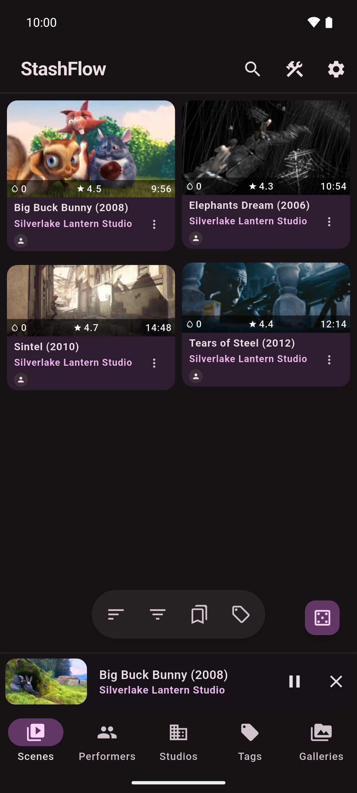
   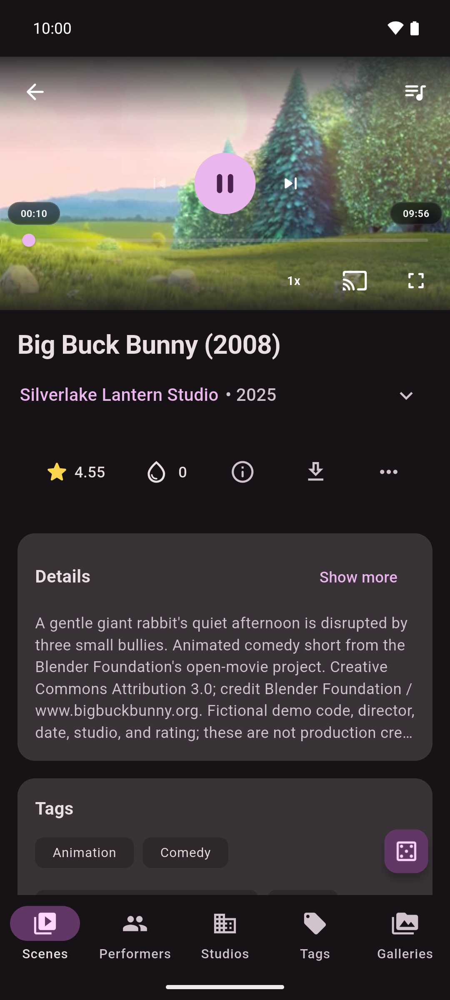
   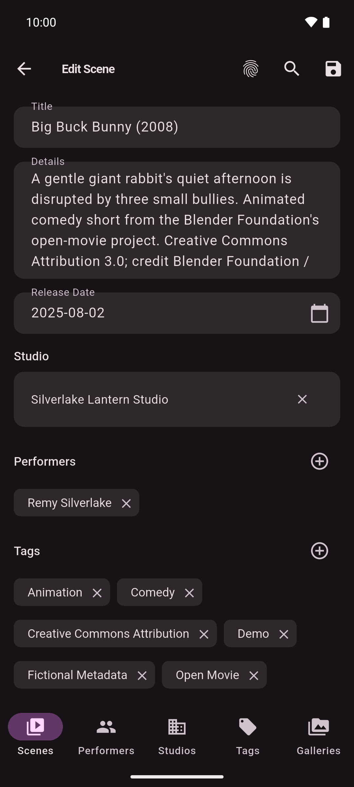

</p>
<p align="center">
   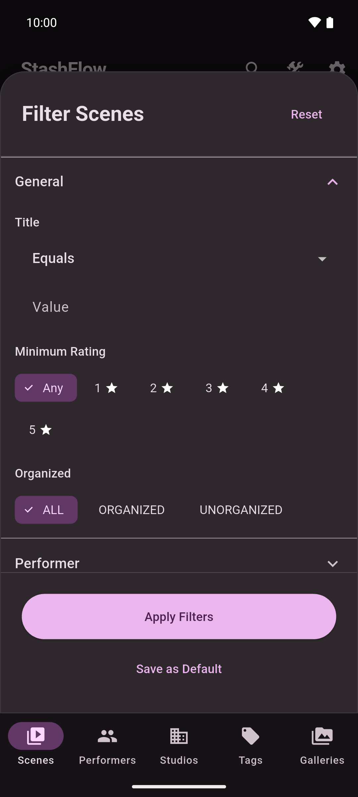
   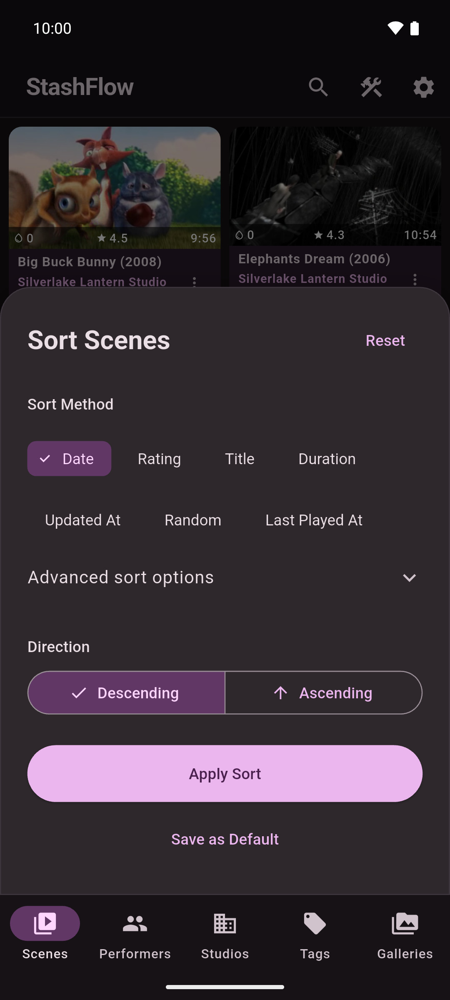
   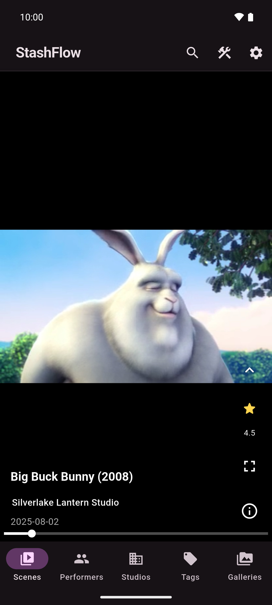
</p>

### Linux desktop

<p align="center">
   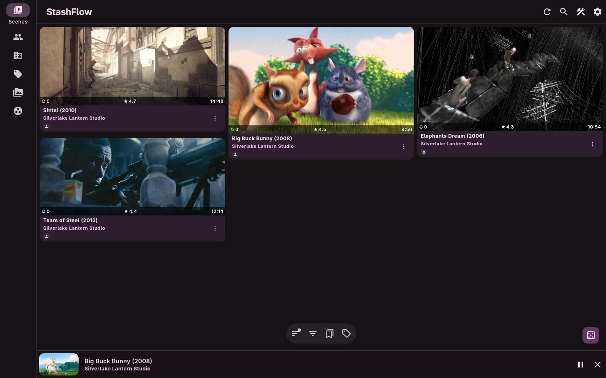
   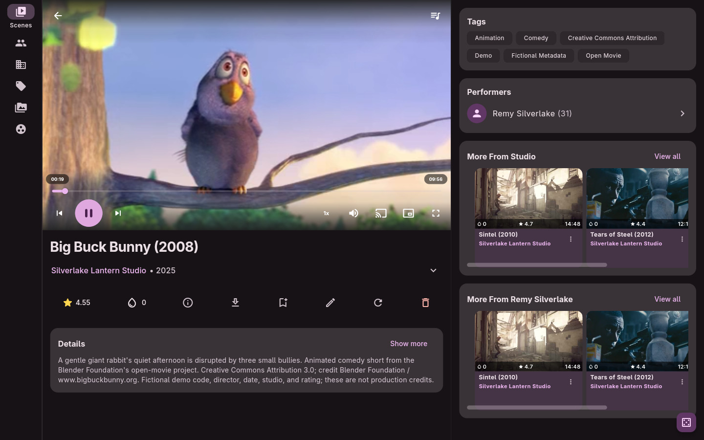
</p>
<p align="center">
   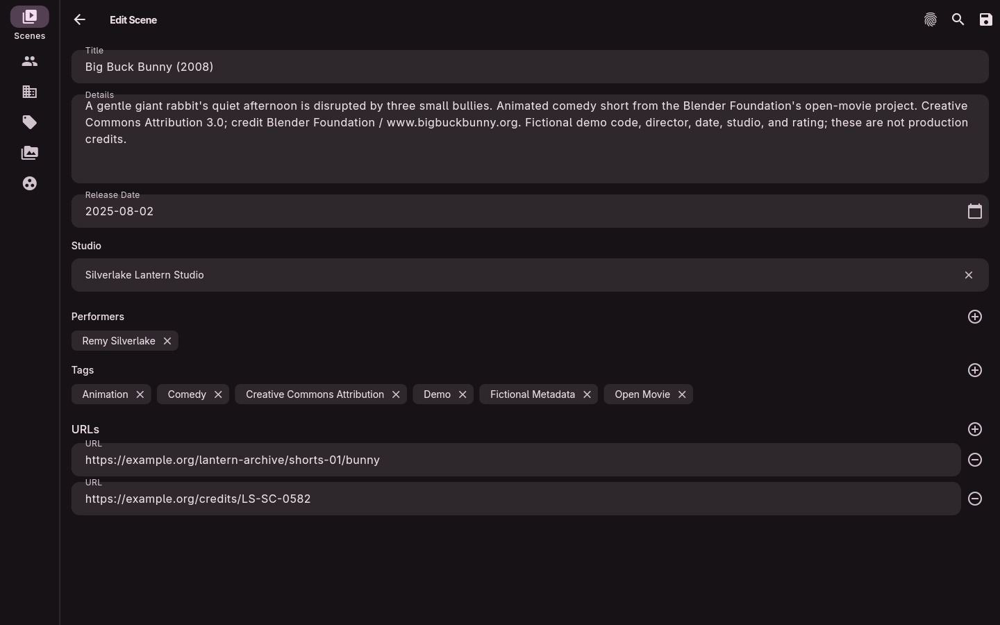
   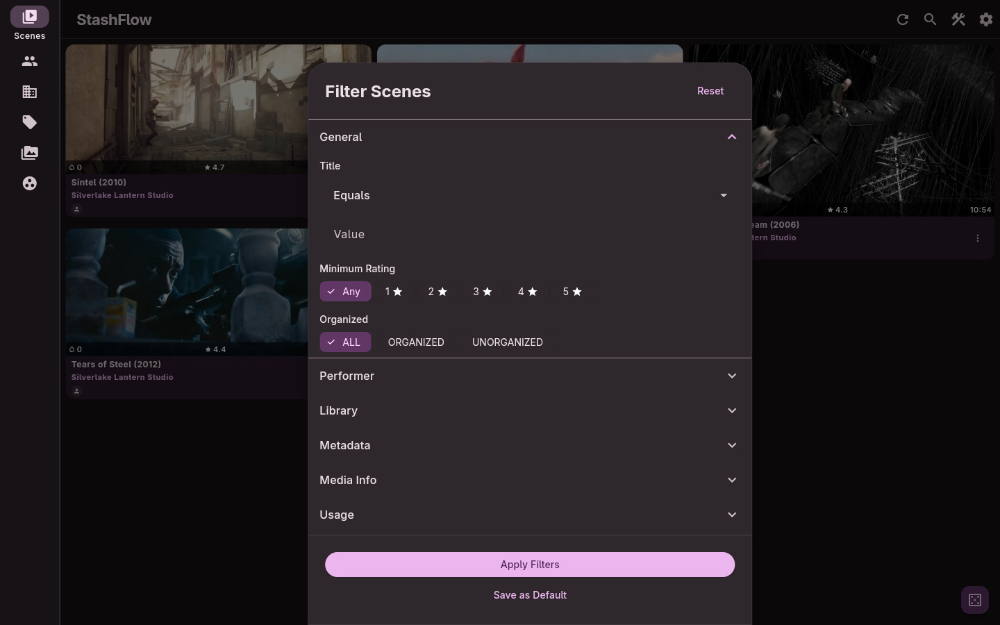
</p>
<p align="center">
   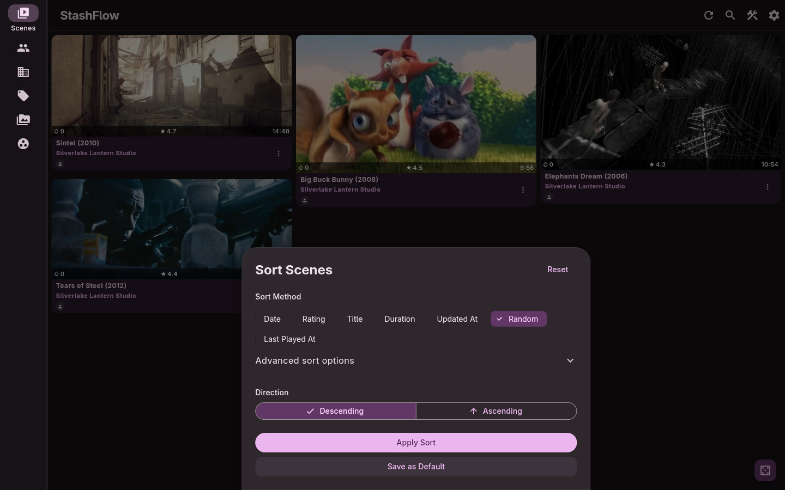
   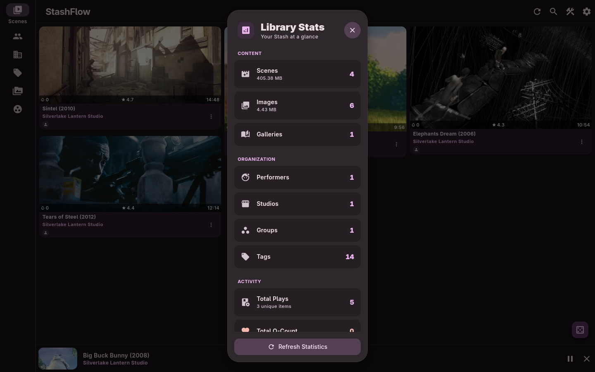
</p>

## ✨ Key Features

- 📱 **Cross-platform** support for Android, desktop, and web.
- 🧭 **Flexible navigation** with customizable primary tabs and responsive layouts.
- 🎬 **Playback tools** including queue continuity, autoplay next, PiP, background audio, cast support, and subtitle controls.
- 💬 **On-device transcription and translation** to generate subtitles even when a scene has none. Choose **Transcribe** in the subtitle menu, then download compatible models in the dialog or **Settings → Playback**. Speech and text stay on-device; generation requires native playback and is unavailable on web or while casting. Speed and accuracy depend on your hardware and models.
- 🖼️ **Media browsing** for scenes, markers, images, galleries, performers, studios, tags, and groups.
- 🔎 **Filtering and sorting** with saved per-page defaults and server-side presets.
- 🛠️ **Editing and scraping** for scene metadata, entity associations, and match merging.
- ⚙️ **Settings coverage** for server profiles, interface, playback, storage, security, keybinds, and developer options.
- 🌐 **Localized UI** with multiple supported languages.

## 🚀 Getting Started

### 📱 Android

Grab the latest APK from the [Releases](https://github.com/Alchemist-Aloha/StashFlow/releases) page, or add StashFlow to [Obtainium](https://github.com/ImranR98/Obtainium) to receive updates automatically:

   [](https://apps.obtainium.imranr.dev/redirect?r=obtainium://add/https://github.com/Alchemist-Aloha/StashFlow)


### 💻 Desktop (Windows, macOS, Linux)

**Download:** Download the appropriate installer for your OS from the [Releases](https://github.com/Alchemist-Aloha/StashFlow/releases) page.

### 🌐 Web

#### Stash Docker image with StashFlow (fully functional)

[`ghcr.io/alchemist-aloha/stash`](https://github.com/Alchemist-Aloha/stash/tree/stashflow) is Stash with the StashFlow web app built in. Stash serves StashFlow from its own address, so **password login** works alongside API keys, and media loads with your Stash session.

To install, replace the official image in your existing Stash setup, keeping everything else the same:

```diff
- image: stashapp/stash:latest
+ image: ghcr.io/alchemist-aloha/stash:stashflow
```

Then open `http://<your-server>:9999/stashflow/`. The official Stash UI stays at `http://<your-server>:9999/`.

For access beyond your local network, put Stash behind an **HTTPS reverse proxy** (such as Caddy, Nginx, or Traefik) so your password and session cookie are encrypted in transit. Have the proxy forward the original `Host` header and `X-Forwarded-Proto`, so Stash generates media links on the same HTTPS address.

#### Hosted demo

The [Live Web App Demo](https://alchemist-aloha.github.io/StashFlow/) is for trying StashFlow out:

- **Authentication:** **API key** only. The browser will not send a Stash session cookie to a page served from another site, so password login needs the Docker image above.
- **Playback:** Limited to the video codecs your browser supports, as with any web version.
- **Recommendation:** Use the Docker image for web, or the **Android** or **Desktop** versions for the complete feature set.

---

## 📚 Internal Docs

For more info, see:

- [Project wiki page](https://github.com/Alchemist-Aloha/StashFlow/wiki)

## Star History

[](https://www.star-history.com/?repos=Alchemist-Aloha%2FStashFlow&type=date&legend=top-left)
